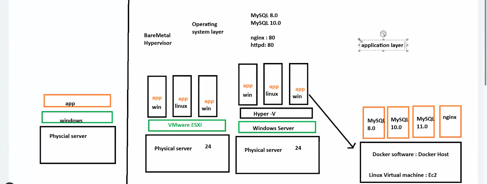

# Docker

Index of Content

1. [Day 1 - Docker Introduction](https://github.com/106-Sam/DevSecOps/tree/dockerbranch/Docker#day-1---docker-introduction)

# Day 1 - Docker Introduction 

**Docker** is a containeriztion tool

### History

1. Physical server --> Windows/Linux OS --> Apps on the Windows/Linux machine
2. Bare-metal Hypervisor | Physical server --> VMware ESXI --> App1 (linux), App2 (windows), App3 (linux)...
   
   Based on hardware specification, we can install multiple operating system.

3. Non Bare Metal Hypervisor | Physical server --> Windows Server --> Hyper-V enabled --> App1 (linux), App2 (windows), App3 (linux)...

Hypervisor virtualizes at Operating System layer

4. Microservices | For every application (App), we need many virtual machine to overcome this we use Docker 
5. Docker | Linux VM (EC2 with docker software installed it becomes docker host) --> We can run multiple application

- We can run different software with different version in the a single OS using docker.

- 

