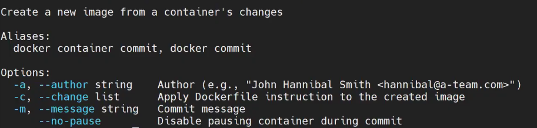

# Docker

Index of Content

1. [Day 1 - Docker Introduction](https://github.com/106-Sam/DevSecOps/tree/dockerbranch/Docker#day-1---docker-introduction)
2. [Day 2 - Container Operations](https://github.com/106-Sam/DevSecOps/tree/dockerbranch/Docker#day-2---container-operations)
3. [Day 3 - Docker Networks](https://github.com/106-Sam/DevSecOps/tree/dockerbranch/Docker#day-3---docker-networks)
4. [Day 4 - Docker Volume and Image Creation](https://github.com/106-Sam/DevSecOps/tree/dockerbranch/Docker#day-4---docker-volume-and-image-creation)
5. [Day 5 - Multi Stage Dockerfile](https://github.com/106-Sam/DevSecOps/tree/dockerbranch/Docker#day-5---multi-stage-dockerfile)
6. [Day 6 - ]


## Day 1 - Docker Introduction 

**Docker** is a containeriztion tool


### History

1. Physical server --> Windows/Linux OS --> Apps on the Windows/Linux machine
2. Bare-metal Hypervisor | Physical server --> VMware ESXI --> App1 (linux), App2 (windows), App3 (linux)...
   
   Based on hardware specification, we can install multiple operating system.

3. Non Bare Metal Hypervisor | Physical server --> Windows Server --> Hyper-V enabled --> App1 (linux), App2 (windows), App3 (linux)...

Hypervisor virtualizes at Operating System layer

4. Microservices | For every application (App), we need many virtual machine to overcome this we use Docker 
5. Docker | Linux VM (EC2 with docker software installed it becomes docker host) --> We can run multiple application

- We can run different software with different version in the a single OS using docker.

- 

What are issue that Docker is solving ?

- We can run multiple application and even the same kind applications with different versions.
- Docker is solving environmental issues.
- We can any docker image to any operating system.
- Docker mainly supports microservice applications (monolith)
- monolith is all the application is made into a single package and we installed it. 


SOA - Service oriented Architecture

Docker Registory - [hub.docker.com](hub.docker.com)

### Installation of Docker 

`apt install docker.io`

#### to run docker without sudo by adding user to docker group

``` bash
sudo usermod -aG docker $USER
newgrp docker 
```

- `docker info` - it displays the information about the docker hosts
- `docker images` - to list all the images that are present locally on the system
- `docker ps` - to list out the running containers ()
- `docker pull <containerName>` - to pull the image locally.

Docker runs in a server-client concept. In backend, `dockerd` services are running. 
`dockerd` is a daemon which acts as a server.
docker cli commands are called as a client.

- by default, the images are taken or pulled from docker hub
- Azure - ACR for container and ECR for AWS
- `docker search <containerName>` - To search container from docker hub via CLI.
- `docker inspect image <containerName>` - To view the layers and updates of an Docker image
- `docker image prune -a` - 

Docker runs linux image if using Linux machine as a host
Docker runs windows image if using windows machne as a host.


## Day 2 - Container Operations

The difference between `locate` and `find` command 
- `find` command goes into all the path in the system and searches for it.
- `locate` command update the new file or directory in the cache and finds it quickly.

Whenever, we inspect a docker image using `docker inspect image <containerName>` we will see `cmd` path which is run by default when we start/execute the images.


#### What is image?

Docker Image is immutable, we can't change anything in an image, image doesn't have any runtime where as container has a runtime and which can be accessible outside and is similar to a Virtual Machine (VM)

- `docker create <imageName>` - To create a container
- `docker create --name <customName> <imageName>` - To create a container with custom name
- `docker create --name <customName> -it <imageName>` - To create ubuntu or operating system related image in interactive mode for /bin/bash 
- `docker attach <contName>` - To attach into the container like operating system but when we exit the contianer also exits 
- `docker run <contName/ImageName>` - run command is a combination of [pull, create, start, attach/detach, stop] docker cli.

- `docker rm <contID/contName` - To delete a container
- `docker rm -f <contID/contName> ` - To stop and delete the container at once (normally force 
delete)
- `docker rmi <imageName>` - To delete the docker images
  
- `docker ps` - this command is to list out the running containers
- `docker ps -a` - this command is to list out all the running/stopped/created (any state) containers
  
- `docker start <contID/contName>` - TO start a container 
- `docker stop <contID/contName>` - TO stop a container 


To run an container in detach mode without exiting 
`docker run -d -it --name ubuntu111 ubuntu`


## Day 3 - Docker Networks

- `docker events` - it displays all the events occured in the backend in docker cli.
- `docker top <contName/ID>` - it displays information related to PPID (processIDs) etc.
- `docker exec -it <contName/ID>` - it login to the container via shell 


#### Difference between attach and exec docker command

- when we use `docker attach` command the docker container gets killed when we exit.
- whereas in `docker exec` command the docker container still runs even after we exit.

#### Requirement in interview if asked we need to use attach command only but when I exit the container must not be killed

- In that scenario we use `docker attach --detach-keys="ctrl-z" <contName/ID>` it takes us to container cli but instead of typing exit we need to press `ctrl+z` button to get out of it without killing the container.


### Networks

- `docker network ls` - To list out the docker host networks

We can see the bridge, host and none networks over there, all the containers by default are created in the bridge network.

- `docker inspect network bridge` - to inspect the bridge network

it shows the subnets cidr range /16 

#### To check if the two docker container are able to communicate with each other or not.

- by default, `ping` command isn't present as many package are removed to reduce the size of the image.
- hence, we need to install the packages for the command.
- `docker run --dit cont1 ubuntu`
- `docker run --dit cont2 ubutnu`
- `docker exec -it cont1 /bin/bash` > `apt update` > `apt install iputils-ping -y`
- `docker exec -it cont2 /bin/bash` > ...
- `docker inspect network bridge` > ping x.x.x.x 

_Note_: Here, we have noticed that we are able to communicate with ip address but not with the container name


#### To create own network bridge

- `docker network create <bridgeName>` - To create the our own bridge network

#### To create docker image in the custom bridge

`docker run -dit --name cont1 --network=<bridgeName> ubuntu`

_Note:_ Now, we are able to communicate with the ip address and also the container name.

> In default network, the name isn't resolve but in the custom bridge network name is resolved

#### Container Port mapping to Host ports

`docker run -d -p8080:80 --name cont1 nginx`
`docker run -d -p8081:80 --name cont2 httpd`

we can access the nginx/httpd server via public ip with the specified ports.

#### Host Network

`docker run -d -p8080:80 --name cont1 --network=host nginx`

*Note: While using host network we can't map the ports to external ports. Hence we can't run two container using same internal ports* 

We can connect to it by using our Host IP address with the default port

- We use `host network` for the database related containers and it doesn't have ip address
- we use `bridge network` for the applications related containers
- we use `none network` if we doesn't need any networks for the containers.


## Day 4 - Docker Volume and Image Creation

Docker, we use only for orchestration and we don't usually use docker instead we use kubernetes which internally uses docker as a pod.

Drawbacks of Docker are:
- No High availability
- No load balancer
- No Auto Scaling 

So dockers main purpose is to create images.

### Docker Volumes

Actual requirement of the volume is that incase, the container crashes the imp data is lost...Hence we attach volumes so we can reattach it and have the data available for us.  (For persistent data)

Even if we stop the container the data is lost


`docker volume ls` - to list out the volumes

- We add multiple container to the same volume

`docker volume create <volumeName>` - To create a volume
 

`docker inspect <volumeName>` - To know the exact path where it is getting stored.

by default linux systempath - /var/lib/docker/volumes/sam/_data

### Volume Mount

WE can mount volumes in 3 ways:

1. --mount

`docker run -dit --name cont1 --mount source=<existingvolumeName>,target=<contdirectoryName> ubuntu`

the data is safe only if the data was create or moved to /<contdirectoryName>

2. -v

`docker run -dit --name cont1 -v <existingVolumeName>:<contDirectoryName> ubuntu`

3. --volumes-from

`docker run -dit --name cont2 --volumes-from cont1 ubuntu`


---

### Attach PWD to container 

`docker run -dit --name cont1 -v "$(pwd)":/data ubuntu`


### Image Creation

Instruction:

1.First, we require a base image and using the base image we will create a container. [base image]
2. Secongly, I will install `iputils-ping` package for `ping` command [ping command]
3. AFter that, I will convert this container into image again. [base image + ping command]
4. Push the image to  hub.docker.com

``` bash

docker run -it --name cont1 ubuntu

   cont1# apt update
   cont1# apt install iputils-ping -y
   exit

docker image inspect ubuntu (one layer is add total 2)

docker exec -it cont1 /bin/bash

docker commit cont1 samIMG
docker iamges

- create your account in hub.docker.com and auth 

docker login -u <username> 
or 
docker login (web based login and paste the code from terminal)

- and make sure when you push the image <username>/<newImage>

docker tag abdulsami106/samIMG:latest  
docker images
docker push abdulsami106/samIMG:latest
```


### docker commit



## Day 5 - Multi Stage Dockerfile

Whatever Image it might be or wherever it might be of it is created by using dockerfile.

Dockerfile - It is a plain text file which we are going to write the instructions.

Dockerfile must be saved as "Dockerfile" it is case sensitive.

#### **Docker Instructions:**

`FROM`  => Base Image
`RUN`  => to execute command, software
`COPY` =>  purpose is to copy files from DockerHost to Image (It will just copy the files as it is )
`ADD` =>   purpose is to copy files from DockerHost to Image (It will extract the .gz .zip file from the DH to Image/Container. Even download the zip files from link but doesn't extract it)
`WORDIRD` => to change directory path
`CMD` => Final Execution (if we run our image it by default runs these)
`ENTRYPOINT` => Final Execution ()
`EXPOSE` => application might run on which port [Documentation Purpose only]
`HEALTHCHECK` => it check the health of our image
`ONBUILD` => Save it for later.
`ENV` => to define the environment variables
`ARGS` => version 


> We don't hae to write/use all the instructions we only need to use the once that are needed.


80% times we only have to write the dockerfiles.

- The code developed by the developer should be converted into an Image.
- So, whenever you use this Image to convert into a container automatically the application should start running.
- And we can use this image in any environment like stage, uat, prod


## Day 6 - COPY and ADD in Docker