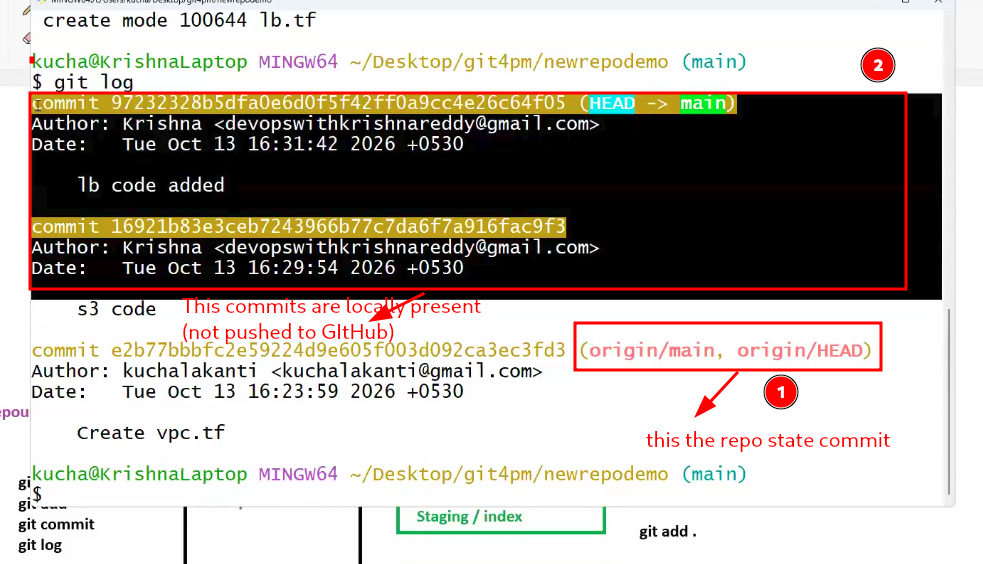
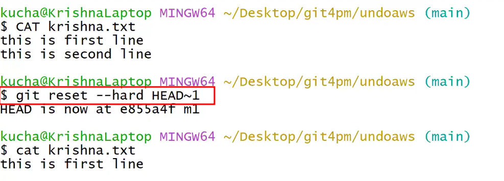
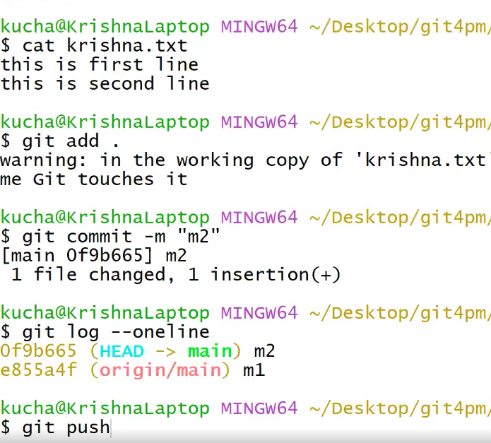
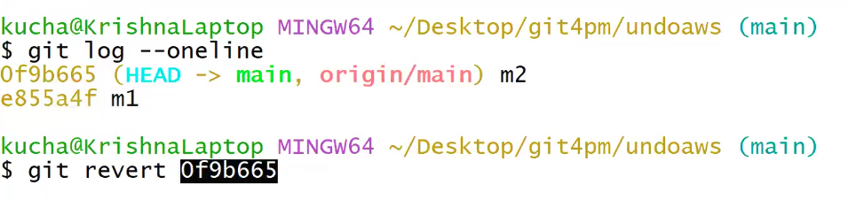

# Git and GitHub 

**Index of Content**

1. [Day 1 - Version Control System in Git](https://github.com/106-Sam/DevSecOps/tree/main/Git%20%26%20Github#day-1---version-control-system-in-git)
2. [Day 2 - Merge Conflicts and Branching Strategies](https://github.com/106-Sam/DevSecOps/tree/main/Git%20%26%20Github#day-2---merge-conflicts-and-branching-strategies)
3. [Day 3 - Git Merge, Square, Rebase, Cherry-Pick Undo](https://github.com/106-Sam/DevSecOps/tree/main/Git%20%26%20Github#day-3---git-merge-squash-rebase-cherrypick-undo-rollback-reset-revert)
4. [Day 4 - Git Pull, Fetch](https://github.com/106-Sam/DevSecOps/tree/main/Git%20%26%20Github#day-4---git-pull-fetch)


## DAY 1 - Version Control System in Git
Version Control: A version control system (VCS) is the software that records changes made to source code, including separate files, sets of files, and any digital assets and related project metadata. This way, the system enables tracking of all project changes and allows developers to revert files to specific versions as needed. Without version control, projects risk becoming disorganized with numerous file versions.

link - [click here](https://www.devart.com/blog/centralized-vs-distributed-version-control.html)

Version control are of 2 types:

- Centralized Version Control: Server & Client
    
    svn: subversion


- Distributed Version Control: Server & Client
    
    git, github

    

### What is Git ?

Git is a local software application, where you can track the version control (change in our code) locally.


### What is GitHub?

GitHub is a cloud-based platform that hosts those code repositories so teams can collaborate online.

| Feature | GIt | GitHub |
|---|---|---|
| Define | Git is a standalone *Version Control System* (VCS) | GitHub is a *cloud based hosting service* built for git |
| Environment | Runs *locally* on our computers | Lives in the *Cloud* (accessible via browsers) |
| Interface | Primary a *command line interface (CLI)* | A visual *Graphical User Interface (GUI)* |
| Internet | Works *offline* | Requires an *Internet connection* |
| Ownership | OpenSource (maintained by the Linux Community) | Owned by *Microsoft* |


### Installation of Git

- Firstly, go to https://git-scm.com/install download as per your operating system.
- git commands can be executed from powershell, command prompt, vs code, git bash, etc.
- *README.MD* file used for documentation of the repo.
- *.gitignore* file is used for not tracking that file. Basically, it will not allow push those file to the GitHub.
- Whenever you see a .git directory (which is hidden) it means it is a git project. 
- Internally git server will be running over there.
  
1. To work on the existing Repo Clone that repository `git clone <url of the repo>`
- by default, we will have multiple stages. 
  - *Working area* - Whenever we make some new changes or create file in the git project it will be in the working area. 
    - You need to use `git status`, it isn't able to track those changes or file. (red color)
    - To add it to the git project, use `git add .` or `git add <filespathwithnames>`it wil make all the file in track. These changes will be moved to the index/stage area.
  - *Stage/Index area* - Now, `git status` shows it is able to track those changes or file (green color) 
    - Use `git commit -m "<message descp>"` -m means message box and now it will take the tracked file / changes /files to commit area
  - *Commit area* - `git log` These all commits are maintained locally. it shows us the commits and those changes aren't yet pushed to GitHub so they will not be appear on the repo. 
    - before push command
        

    - we can authenticate via the username/password, but we will authenticate with the token:
    - `git push` 


### How to get the authentication token 

Step 1: Click on the project picture > Settings > Developer Setting (scroll down)
Step 2: Personal access tokens (PAT)  > Token (classic)
Step 3: Generate new token classic > it will prompt for password > Note (write something) > expire date > Select the scope are per you requirement. > generate > copy the token.
Step 4: It will prompt auth during `git push` choose token > paste the token and sign in


### Git logs commands 

- `git log` - proivde us complete information of the logs.
- `git log --oneline` - provides us with short descp informaton of the logs.

- `git pull` - When we execute git pull it will update the code in the local so that it is same on the repo
- We use `git pull` before `git push` to have prevent the error and issue that will occur later.
- And while pulling we might get the merge conflicts.


## Day 2 - Merge Conflicts and Branching Strategies

2. We are going to create a new repo and then work on it.

- `git init` - it will initialize the current working directory and create .git directory
- `git add .` - to track all the current working directory files then,
- `git commit -m " "`  - it will move the changes to commit area locally
- when we try to push the code it doesn't work as there is no destination for that so, first we create an repo on the GitHub site and use the command `git remote add origin <url>`
 ex: `git remote add origin https://github.com/106-sam/Acube.git`
 - `git remote -v` - to check the destination details.
 - `git push -u origin main/master` - push the code for the first time.


### Merge Conflicts 

Merge conflicts often happen when people make different changes to the same line of the same file, or when one person edits a file and another person deletes the same file.

[click here](https://docs.github.com/en/pull-requests/reference/merge-conflicts)

To resolve the conflicts, the two persons need to sit together and decide which changes are right and keep them. After that they pull the repo

Once solved just do this 
`git rebase --continue` 
`git push -u origin main/master`


### Branching Strategy

Whenever we create a branch, it creates an exact replica of main/master branch along with the commits.

In the new feature branch, we will update the code for the new feature and work on that branch only. And after testing it on the all environments (dev, stage, release, prod) when everything is working fine only then we will merge the code to the main branch by raising Pull Request (PR)

Then the PR request is verfied by the Manager or Team Lead and accept it.

Feature Branch - for creating new feature and getting things ready
Release Branch - this is when the code is ready to deploy. It comes after testing is done.
Hotfix Branch - temp fix for the bugs found on the prod 


`git branch` - to list the branches
`git branch <branch-name>` - to create a new branch
`git switch <branch-name>` - to switch the branch to new branch
`git branch -d <branch-name>` - to delete the branch

_Note: * mark represent the present working branch_

#### Instead of using 2 commands for creating & switching branch do this:

`git checkout -b <branch-name>` - it creates and switches the branch 


`git push origin <branch-name>` - to push the new branch after the commit

and then we need to raise a PR.


## Day 3 - Git Merge Squash Rebase CherryPick Undo RollBack Reset Revert


### Merge and types

In git merge, we have 4 types of merge:
- Merge (standard)
- Squash Merge
- Rebase merge
- Cherry-Pick Merge

1. **Merge** - When we *Merge* the `x` branch to the `main/master` branch it keeps the commit history and add one more commit as merge in the `main/master` branch (merge commit).

``` bash

mkdir merge
cd merge/
git init
touch mmmmm
git add .
git commit -m "m1"
touch mmmmm111
git add .
git commit -m "m2"
git log --online  # commits 2

git checkout -b devbranch

touch dddd
git add .
git commit -m "d1"
touch ddd111
git add .
git commit -m "d2"

git switch main

touch mmmm2222
git add .
git commit -m "m3"

git merge devbranch 
exit the file or write message and exit
git log --oneline # 6 commits includes 1 merge commit
#this provides us all the commits of devbranch as well
```


2. **Squash Merge** - When we *squash merge* the `x` branch to the `main/master` branch it doesn't keep the commit history and replace all those in one commit as we squash merge in the `master/main` branch.

We use squash merge if and only if one person is working on a project.

``` bash

mkdir squash
cd squash/
git init
touch mmmmm
git add .
git commit -m "m1"
touch mmmmm111
git add .
git commit -m "m2"
git log --online  # commits 2

git checkout -b devbranch

touch dddd
git add .
git commit -m "d1"
touch ddd111
git add .
git commit -m "d2"
touch dddddd2222
git add . 
git commit -m "d3"

git switch main

touch mmmm2222
git add .
git commit -m "m3"

git merge --squash devbranch
git commit -m "merged devbranch"
git log --oneline # only 4 commits includes 1 merge commit
# this combines all the commits into one merge commit
```

3. **Rebase** - When we use *rebase merge* the `x` branch to `main/master` branch it has the linear commit history means it will have all the history in the order without extra merge commit.

``` bash

mkdir rebase
cd rebase
git init
touch mmmmm
git add .
git commit -m "m1"
touch mmmmm111
git add .
git commit -m "m2"
git log --online  # commits 2

git checkout -b devbranch

touch dddd
git add .
git commit -m "d1"
touch ddd111
git add .
git commit -m "d2"


git switch main

touch mmmm2222
git add .
git commit -m "m3"
git log --oneline # 3 commits

git switch devbranch
git log --online # 4 commits
git rebase main
git log --online # 5 commits add m3 commit from main branch

git switch main
git rebase devbranch 
git log --online # 5 commits linear history
# This merges in the order linear history order.
```

4. **Cherry-Pick** - We use *cherry-pick* merge to only get the specific commit from the `x` branch to our `main/master` branch.

``` bash

mkdir cherryp
cd cherryp/
git init 

touch provider.tf
git add .
git commit -m "provider"

touch vpc.tf
git add .
git commit -m "vpc"

git checkout -b devbranch

touch s3.tf
git add .
git commit -m "s3"

touch igw.tf
git add .
git commit -m "igw"
git log --oneline

git switch main
git cherry-pick <commit-id>
# it merges only that one file or till that one 1 commit changes 

```

### Undo (untracked file/git working area rollback using checkout)

We undo the changes in a file which is still in the `working area`/untracked file using `git checkout <filename>`  
- it basically rollbacks to the last commit 

``` bash

cat > sam.txt
this is my first line

git status #1 untracked file
git add .
git commit -m "m1"
git push

cat >> sam.txt
this is my second line
this is new line

git status #1 untracked file above new changes
git checkout sam.txt

cat sam.txt # this is my first line
```

### Reset 

`reset` git command consist of 3 arguments based on the requirement:

1. `reset --soft`
   
   - To rollback from commit area to stage area `git reset --soft HEAD~1` 
   - content stays in the stage area and files
   - Here HEAD means top commit

``` bash
#working area
cat > sam.txt
this is my first line

cat >> sam.txt
this is my second line

git status # untracked file 1

#stage area
git add .

#commit area
git commit -m "m1"

#stage area again we can make new changes and commit
git reset --soft HEAD~1
```

2. `reset --mixed`
   
   - To rollback from commit area to working area `git reset --mixed HEAD~1`
   - content stays in the working area and files.
   - Here HEAD means top commit

``` bash

#Previous commands continuation 

git log --oneline # 2 commits

git reset --mixed HEAD~1  # removes the previous commit and moves to working area

```


3. reset --hard
   
   - To rollback from commit area and erase the content of the files you made changes to `git reset --hard HEAD~1`
 - Content erased from files.
 - Here HEAD means top commit




### Revert

 - Revert is used to rollback from pushed code (GITHUB repo) to a specific commit history 
 - it adds Revert commit to the commit history

`git revert <commit-id>` # to revert to that particular git commit version 
`git push`






## Day 4 - Git Pull Fetch 

### Git Pull

**git pull** - We use `git pull`, to update the local code with the updated code from the repository.

`git pull` = `git fetch` + `git merge`


### Git Fetch

**git fetch** - We use `git fetch`, to show the updated code from the repository but it will not update the local code. It will just download the updated code and store it in a separate branch called **FETCH_HEAD**. And then we need to do `git merge` if the changes looks good or promising.


### Git ignore file (.gitignore)

**.gitignore** - If we want to exclude any file, we are going to write those file names in .gitignore file.

``` text

*.py
*.txt
*.tfstate

```

### Git Stash

**git stash** - We use `git stash` to temporary pause the working area (it might be untracked file/tracked file). `git stash -u` -u  means untracked files 

**git stash pop** - We use `git stash pop` to resume the working area. ()

**git stash list** - We use `git stash list` to list out all the stashed files/changes with indexes

**git stash drop** - We use `git stash drop` to delete all the stashed files/changes. `git stash drop stash@{1}` - it has index.

``` bash

touch sam.txt
git status # it has untracked file named "sam.txt"
git stash -u 
git status # working tree clean

```