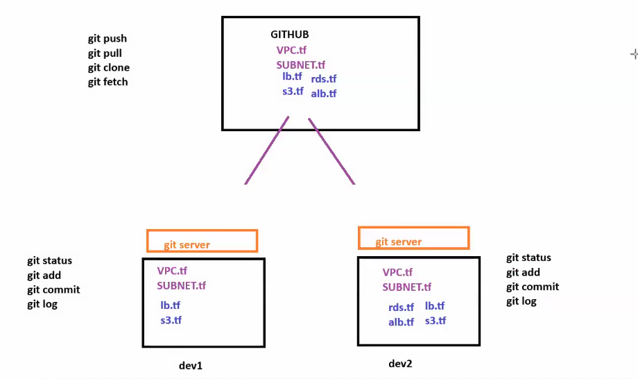

# Git and GitHub 

Version Control: A version control system (VCS) is the software that records changes made to source code, including separate files, sets of files, and any digital assets and related project metadata. This way, the system enables tracking of all project changes and allows developers to revert files to specific versions as needed. Without version control, projects risk becoming disorganized with numerous file versions.

link - [click here](https://www.devart.com/blog/centralized-vs-distributed-version-control.html)

Version control are of 2 types:

- Centralized Version Control: Server & Client
    
    svn: subversion

- Distributed Version Control: Server & Client
    
    git, github

    

### What is Git ?

Git is a local software application, where you can track the version control (change in our code) locally.

### What is GitHub?

GitHub is a cloud-based platform that hosts those code repositories so teams can collaborate online.

| Feature | GIt | GitHub |
|---|---|---|
| Define | Git is a standalone *Version Control System* (VCS) | GitHub is a *cloud based hosting service* built for git |
| Environment | Runs *locally* on our computers | Lives in the *Cloud* (accessible via browsers) |
| Interface | Primary a *command line interface (CLI)* | A visual *Graphical User Interface (GUI)* |
| Internet | Works *offline* | Requires an *Internet connection* |
| Ownership | OpenSource (maintained by the Linux Community) | Owned by *Microsoft* |

### Installation of Git

- Firstly, go to https://git-scm.com/install download as per your operating system.
- git commands can be executed from powershell, command prompt, vs code, git bash, etc.
- *README.MD* file used for documentation of the repo.
- *.gitignore* file is used for not tracking that file. Basically, it will not allow push those file to the GitHub.

### To work on the existing Repo

Step 1: Clone that repository `git clone <url of the repo>`