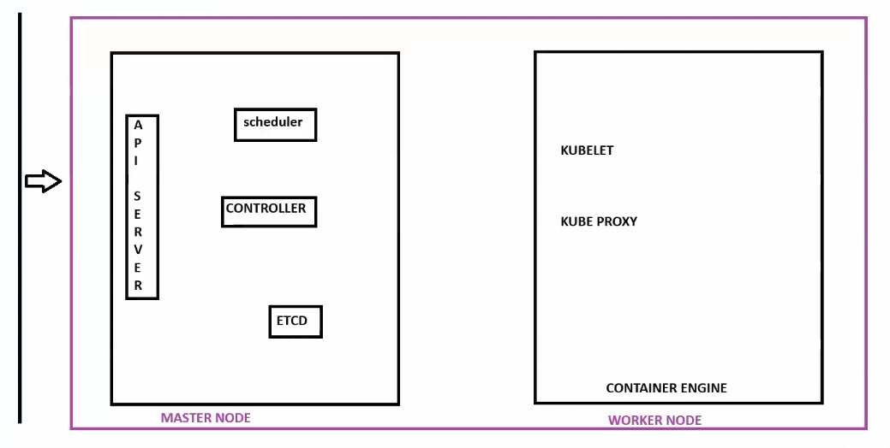

# Kubernetes

Index of Content

1. [Day 1 - Kubernetes Introduction](https://github.com/106-Sam/DevSecOps/tree/main/Kubernetes#day-1---kubernetes-introduction)

## Day 1 - Kubernetes Introduction

#### Challenges with Docker

1. There is no proper failover method for containers.
2. There is no proper failover method for docker host as well.
3. There is no auto scaling features.
4. There is no proper upgrade mechanism for container.

To overcome all these we need container orchestration tool like `Docker swarm`
- Docker swarm supports only docker containers only.

Later, we got `kubernetes` and kuubernetes was a open-source and developed by the Google but later it handed to Cloud-Native and they are maintaining it.

#### Kubernetes

Generally, Kubernetes is container orchestration tool 

Azure: AKS
AWS: EKS
GCP: GKE

We can also use this on ON-PREMISES

IaaS(Infrastructure as a service):
    - EC2: Master
    - EC2: nodez

- In IaaS model, we need to manually configure the Master, Node. Hence, we are going to use EKS.

- EKS is a partially PaaS (Platform as a service) model. As here, we manage the worker nodes

- In kubernetes, we call containers as pods.

#### Kuberneters Components  

1. **Worker Node**: Worker Node is nothing but a docker container or any container engine.
2. **Pod**: Pod is a smallest object that can be created under kubernetes. Pods can have a multiple containers as well (it is a abstraction layer over the container)
3. **IP**: Every Pod has its own IP.
4. **Service as a LoadBalancer or Service as a Cluster IP**:
      - **Cluser IP**: Cluster IP is for internal communication
      - **Load Balancer**: External Communication
      - **Ingress**: External Communication
      - **Node Port**: External Communication

5. config map : Values
6. secrets

- In kubernetes, Pods are created using the `deployment files (deploy.yaml)`.
- We use `config map file`, which contains the DN credentials and configuration for the pods to re-create.
- deployment files, will use the `config maps` as a .env file and use it.
- We can use the config map in two ways: 
  - using environment files 
  - using volume

#### Kubernetes Architecture

##### Master Node Components

- The first component in the Master node/Kubernetes is `API Server`. All the request that is coming from outside is received by the `API Server`.
  
- Then, it goes to `ETCD`. Basically it is NoSQL database. That consist of all the cluster information is stored here.
  
- Then, there is a `Scheduler` & `Controller`.
  
- The `Scheduler` assigns the task to a one of the `Worker Node`.
  
- Generally there are lot of `worker nodes` as per the resource available `Scheduler` will say that you need to do this activity.

- `Controller` is nothing but all the controller like `Node Control`, etc.

##### Worker Node Components

- `Kubelete` - Whatever the information is coming from the `master node` to the `Worker node` needs to pass through `Kubelete`. 
    - Kubelete will start doing the task. 
    - It will connect to the docker or any container history and download the images. 
    - It will create a container and start container.
     
- `KubeProxy` - The `worker node` has many pods every pods works on different urls therefore, all their information is stored in the `kubeproxy`.

- `Container Engine` - Interally in the `worker node` container engine keeps working

To connect to the EKS, we require:
1. aws cli => aws portal - [click here](https://docs.aws.amazon.com/cli/latest/userguide/getting-started-install.html#:~:text=The-,install,-script%20downloads%2C%20verifies)
2. terraform install - [click here](https://developer.hashicorp.com/terraform/install)
3. EKS install - [click here]()
4. kubectl commands - [click here](https://kubernetes.io/docs/tasks/tools/install-kubectl-linux/#install-kubectl-binary-with-curl-on-linux)

To configure kubernetes:
`aws eks --region ap-south-2 update-kubeconfig --name <Name>-cluster`

