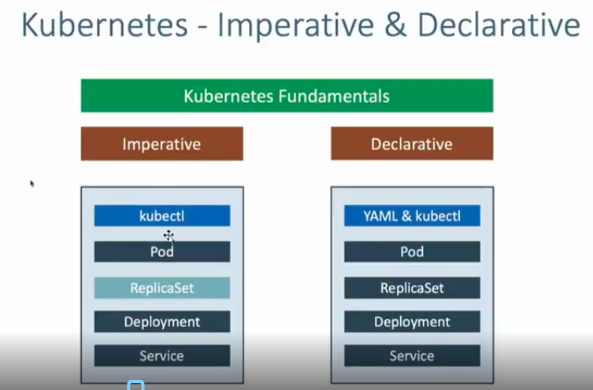
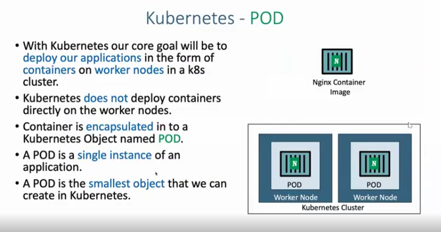
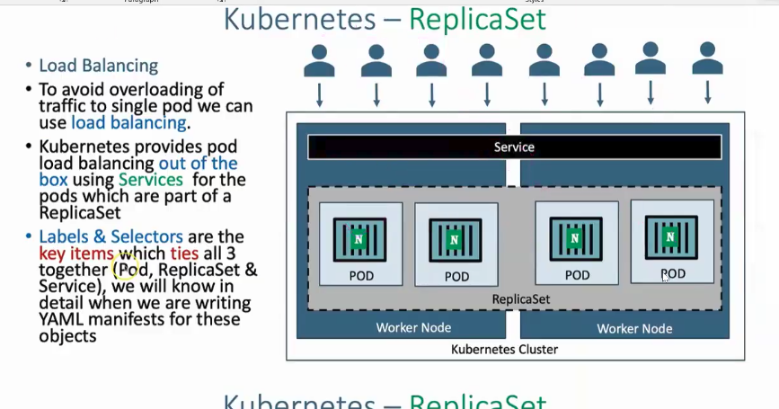
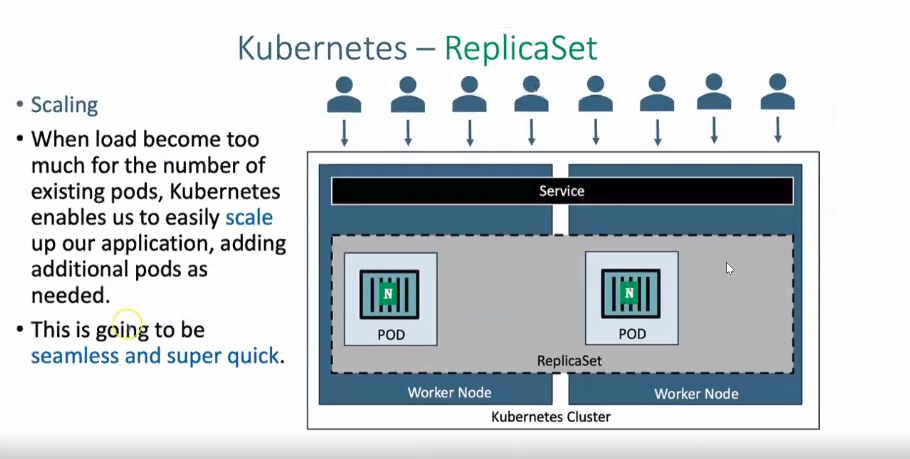
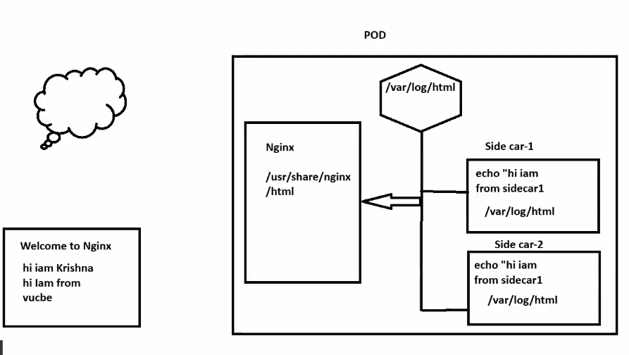
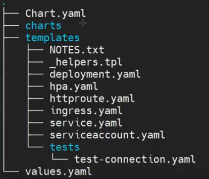

# Kubernetes

Index of Content

1. [Day 1 - Kubernetes Introduction](https://github.com/106-Sam/DevSecOps/tree/main/Kubernetes#day-1---kubernetes-introduction)
2. [Day 2 - Kubernetes Fundamentals](https://github.com/106-Sam/DevSecOps/tree/main/Kubernetes#day-2---kubernetes-fundamentals)
3. [Day 3 - Kubernetes YAML file, namespaces, Sidecar container](https://github.com/106-Sam/DevSecOps/tree/main/Kubernetes#day-3---kubernetes-yaml-file-namespaces-sidecar-container)
5. [Day 4 - Kubernetes ConfigMap, Secrets and Helm Charts](https://github.com/106-Sam/DevSecOps/tree/main/Kubernetes#day-4---kubernetes-configmap-secrets-and-helm-charts)
6. [Day 5 - Helm Charts, Ingress-controller](https://github.com/106-Sam/DevSecOps/tree/main/Kubernetes#day-5---helm-charts-ingress-controller)
7. [Day 6 - ]()


## Kubernetes Commands CheatSheet

#### Nodes Commands

`kubectl get nodes` - to list out all the nodes available.

`kubectl get nodes -o wide` - to list out extra things like External and Internal IP address, OS-version, Status, Age etc.

#### Services Commands
`kubectl get service` - to list out the service it is running as, (by default it gets created as a ClusterIP)

`kubectl expose pod <podName> --type=LoadBalancer --port=80 --name=<nameofService>` - to expose existing pod at 80 port as a loadbalancer (works as a service as a loadbalancer)

#### Pod Commands
`kubectl run <podName> --image <imageName>` -  To create a pod with the specified image name.

`kubectl get pod` - to list out the running/stopped pods (shows info like status, age, pods name, restarts).

`kubectl get pod -o wides` - to list out the pods with some extra information like external ip address and working node detail.

`kubectl describe pod <podName>` - to show more detailed information about the pod including the events. we can find the errors if something went wrong.

`kubectl get all` - to list out all the nodes, services and pods at once.

`kubectl delete pod/<podName>` - to delete the pod from default namespaces.


#### Logs Commands
`kubectl logs <podName>` - to dump pod logs

`kubectl logs -f <podName>` - to stream pod logs and access applications live logs.

#### Executing Commands

`kubectl exec -it <podName> -- /bin/bash` or `kubectl exec -it <podName> -- <shellPath>` - To connect to the pod and execute commands 

`kubectl exec -it <podName> -- <bashCommands>` - to run individual commands in a container.

#### YAML creation Commands

`kubectl get pod <podName> -o yaml` - to get pod defined YAML formatted output.

`kubectl get service <podName> -o yaml` - to get pod defined YAML formatted output.


- `kubectl create deploy myapp --image nginx --dryrun -o yaml > deployment.yaml` - to create/generate a deployment.yaml file.

#### Apply/delete and deploy Commands

`kubectl apply -f <filename>.yaml/.yml` - to deploy the instruction written in the file.

`kubectl delete -f <fileName>.yaml` - to delete all the resource done using deployment yaml files. (all together.)


#### ReplicaSet Commands
`kubectl describe rs <replicaSet-name>` or `kubectl describe rs/<replicaSet-name>` - to describe the newly created replicaSet

`kubectl expose rs <ReplicaSet-Name> --type=LoadBalancer --port=80 --target-port=80 --name=<replicasetName-Service` - to expose replicaset with a service (LoadBalancer) to access the application externally (from internet)

#### API reference resources
  
-  `kubectl api-resources` - to get the API reference related details like v1, short forms etc.

#### Namespace Comamnds

`kubectl get ns` or `kubectl get namespace` - to list out the existing namespaces (by default: default-namespace)

`kubectl create ns <namespaceName>` - To create a new namespace in kubernetes

`kubectl apply -f deployment.yaml --namespace <namespaceName` - to deploy the application in the specified namespace.

`kubectl get pod --namespace <namespaceName>` - to list out the pods from the specified namespace

`kubectl get all --namespace <namespaceName>` - to list out all the nodes, services and pods at once but from the specified namespace.

#### ConfigMaps Commands

`kubectl get cm ` - to list out the existing ConfigMaps
`kubectl describe cm <configMapNames>` - To describe the specified ConfigMap 

#### Secrets Commands

`kubectl create secret generic <secretName> --from-literal=<passValue>` - to create and pass a secret value.

`kubectl describe secret <secretName>` - to describe the exisiting secrets

`kubectl edit secret <secretName>` - to edit the secrets files/view secret file

#### Ingress Commands

`kubectl get ingress` - to list out the ingress controller Path routing

---

## Helm Cheatsheet

`helm install <appName> .` - to install a helm package from the chart.yaml file from the present directory.

`helm uninstall <appName>` - to uninstall a helm package.

`helm upgrade <appName> .` - to upgrade the helm package after editing the yaml files from the present directory.

`helm upgrade <appName> . --set replicaCount=3` - to upgrade the helm package once the variable are declare and values can be passed via cli.

`helm history <appName>` = to check the history of the app. (can be used for rollback)

`helm rollback <appName> <RevisionNumber>` - to rollback to a specific version and provide the revision number.


***

## Day 1 - Kubernetes Introduction

#### Challenges with Docker

1. There is no proper failover method for containers.
2. There is no proper failover method for docker host as well.
3. There is no auto scaling features.
4. There is no proper upgrade mechanism for container.


To overcome all these we need container orchestration tool like `Docker swarm`
- Docker swarm supports only docker containers only.

Later, we got `kubernetes` and kuubernetes was a open-source and developed by the Google but later it handed to Cloud-Native and they are maintaining it.


#### Kubernetes

Generally, Kubernetes is container orchestration tool 

Azure: AKS
AWS: EKS
GCP: GKE

We can also use this on ON-PREMISES

IaaS(Infrastructure as a service):
    - EC2: Master
    - EC2: nodez


- In IaaS model, we need to manually configure the Master, Node. Hence, we are going to use EKS.

- EKS is a partially PaaS (Platform as a service) model. As here, we manage the worker nodes

- In kubernetes, we call containers as pods.

#### Kubernetes Components  

1. **Worker Node**: Worker Node is nothing but a docker container or any container engine.
2. **Pod**: Pod is a smallest object that can be created under kubernetes. Pods can have a multiple containers as well (it is a abstraction layer over the container)
3. **IP**: Every Pod has its own IP.
4. **Service as a LoadBalancer or Service as a Cluster IP**:
      - **Cluser IP**: Cluster IP is for internal communication
      - **Load Balancer**: External Communication
      - **Ingress**: External Communication
      - **Node Port**: External Communication

5. config map : Values
6. secrets

- In kubernetes, Pods are created using the `deployment files (deploy.yaml)`.
- We use `config map file`, which contains the DN credentials and configuration for the pods to re-create.
- deployment files, will use the `config maps` as a .env file and use it.
- We can use the config map in two ways: 
  - using environment files 
  - using volume

#### Kubernetes Architecture


##### Master Node Components

- The first component in the Master node/Kubernetes is `API Server`. All the request that is coming from outside is received by the `API Server`.
  
- Then, it goes to `ETCD`. Basically it is NoSQL database. That consist of all the cluster information is stored here.
  
- Then, there is a `Scheduler` & `Controller`.
  
- The `Scheduler` assigns the task to a one of the `Worker Node`.
  
- Generally there are lot of `worker nodes` as per the resource available `Scheduler` will say that you need to do this activity.

- `Controller` is nothing but all the controller like `Node Control`, etc.


##### Worker Node Components

- `Kubelete` - Whatever the information is coming from the `master node` to the `Worker node` needs to pass through `Kubelete`. 
    - Kubelete will start doing the task. 
    - It will connect to the docker or any container history and download the images. 
    - It will create a container and start container.
     
- `KubeProxy` - The `worker node` has many pods every pods works on different urls therefore, all their information is stored in the `kubeproxy`.

- `Container Engine` - Interally in the `worker node` container engine keeps working


To connect to the EKS, we require:
1. aws cli => aws portal - [click here](https://docs.aws.amazon.com/cli/latest/userguide/getting-started-install.html#:~:text=The-,install,-script%20downloads%2C%20verifies)
2. terraform install - [click here](https://developer.hashicorp.com/terraform/install)
3. EKS install - [click here](https://github.com/eksctl-io/eksctl)
4. kubectl commands - [click here](https://kubernetes.io/docs/tasks/tools/install-kubectl-linux/#install-kubectl-binary-with-curl-on-linux)


To configure kubernetes:

`aws eks --region ap-south-2 update-kubeconfig --name <Name>-cluster`


## Day 2 - Kubernetes Fundamentals

_Note: worker node and master node will always be in the EKS/AKS/GKE, etc but not outside it._

#### Setting up machine for managing kubernetes

1. AWS CLI:
   - install aws-cli, and then `aws configure` (default installed in EC2 Instance)
   - create IAM user, provide it a role to it and access keys.
   - `aws eks --region ap-south-2 update-kubeconfig --name <Name>-cluster`
   - `kubectl get nodes` - to check if the nodes are up or not.


#### Kubernetes Fundamentals

1. **Pod:** A POD is a single instance of an Application.
   
      - A POD is a smallest object, that can be created in kubernetes.
  
2. **ReplicaSet:** A ReplicaSet will maintain a stable set of replica Pods running at any given time. 
      -  In short, it is often used to guarantee the availability of a specified number of identical Pods.
3. **Deployment:** A deployment run multiple replicas of your application and automatically replaces any instances that fall or become unresponsive. 
      -  Rollout & Rollback changes to applications.
      -  Deployments are well-suited for the stateless applications.
4. **Service:** A service is an abstraction for pods, providing a stable, so called virtual IP (VIP) address.
      - In simple terms, service sits infront of a POD and acts as a load balancer.

##### 1. POD






##### 2. ReplicaSet





## Day 3 - Kubernetes YAML file, namespaces, Sidecar container

- YAML file can be of extension .yaml or .yml.
- YAML is similar to markup language where it is user-friendly but only thing is to take care of the indentation.

```yaml
person: #dictonary
      name: Sami # keyvalue pair
      occupation: DevSecOps Engg. # keyvalue pair
      city: Hyderabad # keyvalue pair
      hobbies: #list
       - basketball
       - reading
       - researching
      friends: #list of dictonaries
       - name: Khush
         city: kanpur
       - name: Ammarah
         city: Hyderabad
       - name: Veeni
         city: London
       - name: Sourav 
         city: Bangalore
       - name: Pragati
         city: Hyderabad   
```

Kubernetes: [YAML API reference](https://kubernetes.io/docs/concepts/workloads/pods/)

#### Example POD YAML

filename: pod.yaml

```yaml
apiversion: v1
kind: Pod
metadata:
  name: mypod
spec:
  containers:
    - name: nginx
      image: nginx
      port: 80
    - containerPort: 80
```

YAML Validator - [link](https://www.yamllint.com/)

`kubectl apply -f pod.yaml` 
`kubectl get pods` - this shows us the ip address of the node where it is deployed
`kubectl get nodes` - this shows us all the nodes.
`kubectl describe pod mypod` - to see the events

> NOTE: 
>  - We cannot see the master node as we are using AWS EKS service
>  - Master Node is basically managed by AWS. Instead we can login and connect to the worker nodes.


#### Example Service YAML

filename: service.yaml

```yaml
apiversion: v1
kind: Service
metadata:
  name: my-loadbalancer-svc
spec:
  type: LoadBalancer
  selector: 
    app: mypod
  ports: 
    - name: http
      protocol: TCP
      port: 80         #This port is exposed externally on the LoadBalancer
      targetPort: 80

```

`kubectl get svc` - to list if there is any LoadBalancer service already running.
`kubectl apply -f service.yaml` - to deploy the service.yaml file configuration.
`kubectl get svc` - now we can see the kubernetes service that we just deployed.
`kubectl delete -f service.yaml`
or
`kubectl get all`
`kubectl delete pod/mypod`


#### Example Pod & Service YAMl file together

filename: deploy.yaml

```yaml
apiversion: v1
kind: Pod
metadata:
  name: mypod
spec:
  containers:
    - name: mypod
      image: nginx
      port: 80
    - containerPort: 80

---
apiversion: v1
kind: Service
metadata:
  name: my-loadbalancer-svc
spec:
  type: LoadBalancer
  selector: 
    app: mypod
  ports: 
    - name: http
      protocol: TCP
      port: 80         #This port is exposed externally on the LoadBalancer
      targetPort: 80
```

- we have used "---" in between that is the document seperator.
- `kubectl apply -f deploy.yaml`
- ingress control

#### To create a Deployament YAML file with kubectl 

`kubectl create deploy myapp --image nginx --dryrun -o yaml > deployment.yaml`


`kubectl apply -f deployment.yaml`

#### To create a service YAML file with the kubectl 

`kubectl expose deploy myapp --port=80 --type=LoadBalancer --dryrun -o yaml > service.yaml`


`kubectl apply -f service.yaml`

#### Namespace

`kubectl get ns` or `kubectl get namespace` - to list out the existing namespaces (by default: default-namespace)

`kubectl create ns <namespaceName>` - To create a new namespace in kubernetes

`kubectl apply -f deployment.yaml --namespace <namespaceName` - to deploy the application in the specified namespace.

`kubectl get pod --namespace <namespaceName>` - to list out the pods from the specified namespace

`kubectl get all --namespace <namespaceName>` - to list out all the nodes, services and pods at once but from the specified namespace.


#### Sidecar Container (Multi-Container Pod)

- Sidecar container is nothing but a helping container for the main container.
- It is used to pull data required by the main container.
- It is used to push data by collecting from main container (logs)
- It writes static data to the html files Helper Container and Reads using Main Containers.



```yaml

apiversion: v1
kind: Deployment
metadata: 
  creationTimestamp: null
  labels:
    app: nginx-webapp
  name: nginx-webapp
spec: 
  replicas: 2 
  selector: 
    matchLabels 
      app:nginx-webapp

strategy: {}
template: 
  metadata:
    creationTimestamp: null
    labels:
      app: nginx-null
  spec:
    containers:
      - image: busybox
        command: ["/bin/sh"]
        args: ["-c", "while true; do echo echo $(date -u)] 'Hi I am from Sidecar container1' >> /var/log/index.html; sleep 5; done"]
        name: sidecar-container1
        resource: {}
        volumeMount: 
          - name: var-logs
            mount: /var/log

      - image: busybox
        command: ["/bin/sh"]
        args: ["-c", "while true; do echo echo $(date -u)] 'Hi I am from Sidecar container2' >> /var/log/index.html; sleep 5; done"]
        name: sidecar-container2
        resource: {}
        volumeMount: 
          - name: var-logs
            mount: /var/log

      - image: nginx
        name: main-container
        resource: {}
        ports: 
          - containerPort: 80
      volumeMounts: 
      - name: var-logs
        mountPath: /usr/share/nginx/html
      dnsPolicy: Default
      volumes: 
        - name: var-logs:
          emptyDir: {}
status: {}

---

apiversion: v1
kind: Service
metadata : 
  name: nginx-webapp
  labels: 
    run: nginx-webapp

spec: 
  ports: 
    - port: 80
      protocol : TCP
  selector: 
    app: nginx-web
  type: LoadBalancer         

```

`kubectl apply -f sidecar.yaml`


## Day 4 - Kubernetes ConfigMap, Secrets and Helm Charts

A **ConfigMap** is a Kubernetes API object used to store non-confidential configuration data as key-value pairs.

The problem that `ConfigMap` solves is if the configuration like dbport and all are configured by us after connecting to the pod. In case, the pod crashes and new pod spawns, we need to do all that steps manually. Instead, we can use `ConfigMap` and provide it the values.

We can use three methods,
1. Environment Variable - If using Env variable, and change data in the ConfigMap file the pods needs to restart pods to get the changes apply.
2. Filesystem Volumes - If using volume, and changed data in ConfigMap file the running pod data is automatically get changes.
3. Command Line Arguments 

Kubernetes stores ConfigMaps in its etcd datastore. You shouldn't directly edit etcd data; instead, use Kubernetes API server and Kubectl to create and manage your ConfigMaps.


```text
Kubernetes ConfigMap is a built-in Kubernetes API object that’s designed to store your application’s non-sensitive key-value config data. ConfigMaps allow you to keep config values separate from your code and container images. Values can be strings or Base64-encoded binary data.
Once you’ve created a ConfigMap, its content will be saved to your Kubernetes cluster. Pods can then consume the ConfigMap’s values as environment variables, command line arguments, or filesystem volumes.

ConfigMaps are intended to store relatively small amounts of simple data. The total size of a ConfigMap object must be less than 1 MiB. If you need to store more data, you should split your configuration into multiple ConfigMaps or consider using a separate database or key-value store.
It’s good practice to use a ConfigMap to supply any configurable values that your app needs at runtime. The key-value pairs within the ConfigMap can be injected directly into your Pods in several different formats. Because ConfigMaps are part of the Kubernetes API, it’s possible to alter their values without re-deploying your app’s Pods.


```
Interview Prep - [Click here](https://docs.google.com/document/d/1CkKLztqDNX2JKr2urSqa8bqo32VxL8TH/edit)


#### To create our own ConfigMap (without ENV/Volumes)

`kubectl get cm ` - to list out the existing ConfigMaps

filename: cm.yaml
```yaml
apiversion: v1
kind: ConfigMap
metadata:
  name: test-cm
data:
  db-port: 3306
```

`kubectl apply -f cm.yaml` 
`kubectl get cm`
`kubectl describe cm test-cm` - To describe the specified ConfigMap 

```yaml
apiversion: v1
kind: Deployment
metadata:
  name: myapp1-deployment
spec:
  replicas: 2
  selector: 
    matchLabels:
      app: myapp1
  template: 
    metadata: # Dictonary
      name: myapp1-Pod
      labels: # Dictonary
        app: myapp1
      spec: 
        containers: #List
          - name: myapp1-container
            image: kuchalakantikris/my_nginx_image1:v1
            ports:
              - containerPort: 80

```

`kubectl apply -f deployment.yaml`
`kubectl get pods` 
`kubectl exec -it myapp1-deployment-xxxxx-xx -- /bin/bash `
> $ env
>
> $ export DB_PORT=3306
> 
> $ env

`kubectl delete pod myapp1-deployment-xxxx-xx` 

Now, after delete the new pod will not have that same value/configuration.

`kubectl delete -f deployment.yaml`

#### To create our own ConfigMap (with Environment Variable)

```yaml
apiversion: v1
kind: Deployment
metadata: 
  name: myapp1-deployment
spec: 
  replicas: 2
  selector: 
    matchLabels:
      app: myapp1
  template: 
    metadata: # Dictonary
      name: myapp1-pod 
      labels: 
        app: myapp1
      spec: 
        containers: # List
          - name: myapp1-container
            image: kuchalakantikris/my_nginx_image1:v1
            env: 
              - name: DB-PORT
                valueFrom:
                  configMapKeyRef: 
                    name: test-cm
                    key: db-port

            ports:
              - containersPort: 80
```

filename: cm.yaml
```yaml
apiversion: v1
kind: ConfigMap
metadata: 
  name: test-cm
data:
  db-port: "3306"

```
`kubectl get pods`

`kubectl exec -it pod -- env`

- Even if we delete the pods the environment variable values will be there.

Now if i want to change the value of that particular environment variable in runtime:
- I will edit the configmap
  
filename: cm.yaml
```yaml
apiversion: v1
kind: ConfigMap
metadata: 
  name: test-cm
data:
  db-port: "3307"

```

`kubectl apply -f cm.yaml`

`kubectl describe cm test-cm` 

- The value has even changed when we see describe the configmap service 
- But there was no change on the Running Pods

`kubectl delete pod *` 

- And after new pods are created now we can see that values changed.
- Hence, we need to restart the pods to change the values at the runtime.

#### To create our own ConfigMap (with Filesystem Volumes)

```yaml
apiversion: v1
kind: Deployment
metadata: 
  name: myapp1-deployment
spec: 
  replicas: 2
  selector: 
    matchLabels:
      app: myapp1
  template: 
    metadata: # Dictonary
      name: myapp1-pod 
      labels: 
        app: myapp1
      spec: 
        containers: # List
          - name: myapp1-container
            image: kuchalakantikris/my_nginx_image1:v1
            volumeMounts: 
              - name: db-connection
                mountPath: /opt
            ports:
              - containersPort: 80
        volumes: 
          - name: db-connection
            configMap: 
              name: test-cm 
```

filename: cm.yaml
```yaml
apiversion: v1
kind: ConfigMap
metadata: 
  name: test-cm
data:
  db-port: "3306"

```
`kubectl deploy -f deployment.yaml` 

`kubectl exec -it <pod> -- /bin/bash` 

> $ cat /opt/db-port

- if we change the value and deploy again with configmap yaml it changes at the runtime.

#### Kubernetes Secrets

#### Example secret yaml
filename: secrets.yaml
```yaml
apiVersion: v1
kind: Secret
metadata: 
  name: my-app-secret
  namespace: default

type: Opaque
data:
  # Value must be base64 encoded without newlines
  username: YWRtaW4=      # admin
  password:                 # supersecret

  # Kubernetes automatically encodes plain-text values in stringData
  api-key: "my-plain-text-api-key"
```


`kubectl create secret generic test-secret --from-literal=db-port="3306"`

`kubectl describe secret test-secret`

`kubectl edit secret test-secret`


#### Helm Charts

- Helm Chart is a package manager for the kubernetes. We normally package all the yaml file and give it a name.
- Helm Charts solve the problem of deploy multiple yaml files.

Helm installation - [click here](https://helm.sh/docs/intro/install/)

#### demo to create a helm 

`sudo helm create myapp`


- Chart.yaml - it is for the chart defination
- charts directory - it is for the dependency files
- templates directory - We write the deployment yaml files in the templates

`helm install myapp` - to install the helm chart
`helm uninstall myapp` - to uninstall the helm chart
`helm upgrade myapp` - to upgrade the helm chart
`helm rollback myapp 1` - to rollback to a specific part in helm chart


## Day - 5 Helm Charts, Ingress Controller

- What is the use of ConfigMap ?
Ans. The use for configmap is to store and pass value to the Kubernetes Pod.

- How much size should ConfigMap be?
Ans. Less than 1Mib

- How many ways we can pass the values?
Ans. Three ways - Environment Variable, CLI arguments, Filesystem volumes

- What is the difference between environment variable and Filesystem volumes?
Ans. Environment variable doesn't change the value at Runtime therefore, we need to restart the pod. Whereas Filesystem volumes do change the values at Runtime.

- How to create container ?
Ans. Pod and container are the same. And Pod can have multiple containers.



#### Creation of helm package

`mkdir myapp`
```yaml
vi Charts.yaml

apiVersion: v2
name: myapp
version: 0.1.0
appVersion: 1.0
description: A Helm Chart for kubernetes
```

`mkdir templates`
`cd templates`
`kubectl create deploy myapp --image nginx --dry-run -o yaml > deployment.yaml`
`cd ..`
`aws eks --region ap-south-2 update-kubeconfig --name krishna-cluster`
`kubectl get nodes`
`helm install myapp .`
`kubectl get pods` #it shows the created pod from myapp.
`helm uninstall myapp` 


#### Increasing replicas in deployment.yaml

`helm install myapp .`

```yaml
vi templates/deployments.yaml

apiVersion: app/v1
kind: Deployment
metadata: 
  labels: 
    app: myapp
  name: myapp
spec: 
  replicas: 3 # changed 1 to 3
  selector: 
    matchLabels: 
      app: myapp
  strategy: {}
  template: 
    metadata: 
      labels: 
        app: myapp
    spec: 
      containers: 
        - image: nginx
          name: ngixn
          resource: {}
status: {}
```

- if we want we can change the app version in the chart.yaml file.

```yaml 
vi chart.yaml

apiVersion: v2
name: myapp
version: 0.1.1
appVersion: 1.0
description: A Helm Chart for kubernetes
```
`helm upgrade myapp .`
`kubectl get pods`  # we will see 3 pods as replicas to 3

#### If we want to rollback to specific version
`helm history myapp` 
`helm rollback myapp 1` - check the history and write the number sequel as per requirement.
`kubectl get pods`  # pods changed to 1 but didn't change the replica value 


`cd templates`
`kubectl expose deploy myapp --port 80 --type=LoadBalancer --dry-run -o yaml > service.yaml`
`helm upgrade myapp .`

`kubectl gets pods` # 3 pods 
`kubectl get nodes` # new service loadbalancer is added. 2 services

`helm rollback myapp 1` # it again roll back to 1 pod 1 service.

#### Passing Variable and values

```yaml 
vi templates/deployments.yaml

apiVersion: app/v1
kind: Deployment
metadata: 
  labels: 
    app: myapp
  name: myapp
spec: 
  replicas: {{.Values.replicaCount}}
  selector: 
    matchLabels: 
      app: myapp
  strategy: {}
  template: 
    metadata: 
      labels: 
        app: myapp
    spec: 
      containers: 
        - image: nginx
          name: ngixn
          resource: {}
status: {}

```
`touch values.yaml` 
```yaml 
vi values.yaml

replicaCount: 1
```
`helm install myapp .`

- Once we have declared a variable we can give the values from the commandline arguments as well.
  
`helm upgrade myapp . --set replicaCount=3`

`kubectl get pods`

#### HELM Charts Repository 

[helm.sh](https://helm.sh)

And click Charts in the menu


We have installed Postgresql it didnt work due to volume storage less
Hence, we did instal nginx by copy paste from bitnami
Then, prometheus


#### Ingress Controller

Basically, Ingress Controller helps us reduce the cost without using the Load Balancers.

If 2 servers are deployed like nginx and Httpd in a same cluster, we need 2 load balancer to access them. Instead we can use Ingress Controller, which will act as a load balancer. 


we can access application using 1 PublicIP and using default routing rules
- publicIP/nginx - nginx server
- publicIP/httpd - httpds Server


So, instead of using multiple load balancer, we can use ingress-controller with Path based routing rules.

link is here 

https://github.com/kubernetes/ingress-nginx/blob/controller-v1.2.1/deploy/static/provider/cloud/deploy.yaml

`kubectl apply -f https://raw.githubusercontent.com/kubernetes/ingress-nginx/refs/tags/controller-v1.2.1/deploy/static/provider/cloud/deploy.yaml`

ingress controller is created in the namespace `ingress-nginx`

`kubectl get pods --namespace ingress-nginx`

- created nginx.yml & httpd.yml file

`kubectl apply -f nginx.yml`
`kubectl apply -f httpd.yaml` 

create a ingress-resource backend linked httpd and nginx yaml

`kubectl apply -f ingress-resource.yaml`

`kubectl get ingress`

- we need to get the link from ALB till then wait
- after that we can access nginx and httpd with path routing


## Day 6 - 