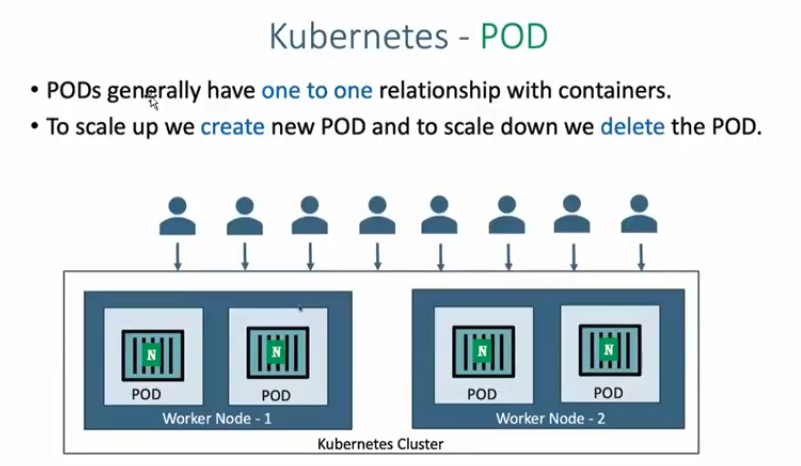
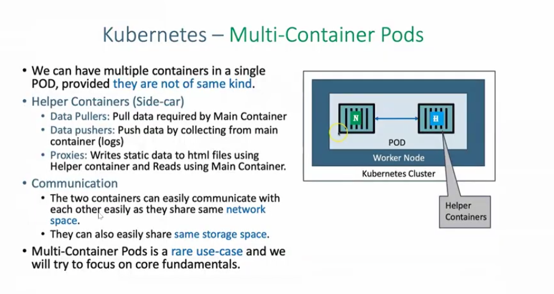
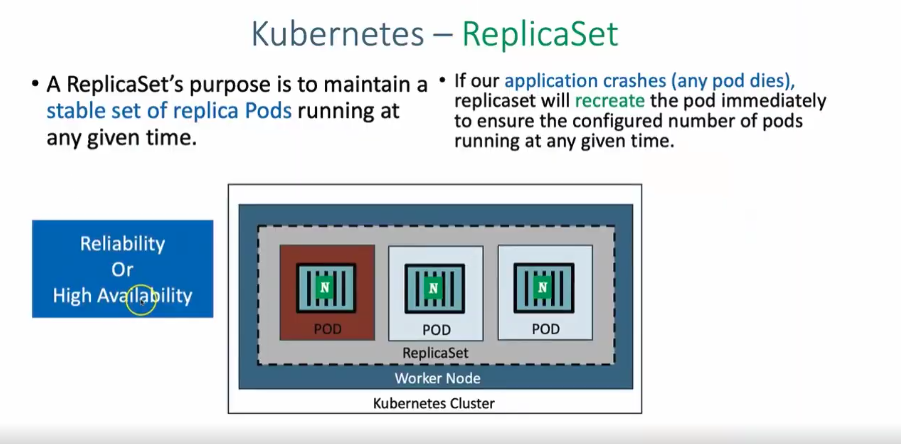
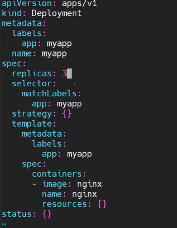
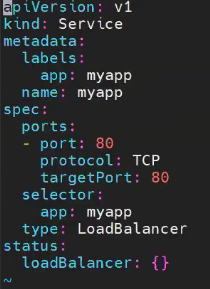
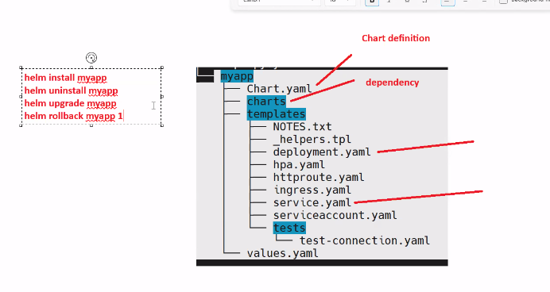

# Kubernetes

Index of Content

1. [Day 1 - Kubernetes Introduction](https://github.com/106-Sam/DevSecOps/tree/main/Kubernetes#day-1---kubernetes-introduction)
2. [Day 2 - Kubernetes Fundamentals](https://github.com/106-Sam/DevSecOps/tree/main/Kubernetes#day-2---kubernetes-fundamentals)
3. [Day - 3 Kubernetes YAML file and namespaces](https://github.com/106-Sam/DevSecOps/tree/main/Kubernetes#day-3---kubernetes-yaml-file-and-namespaces)
4. [Day - 3 Kubernetes YAML file, namespaces, Sidecar container](https://github.com/106-Sam/DevSecOps/tree/main/Kubernetes#day-4---kubernetes-yaml-file-namespaces-sidecar-container)
5. [Day - 4 Kubernetes and HELM Chart]


## Kubernetes Commands CheatSheet

#### Nodes Commands

`kubectl get nodes` - to list out all the nodes available.

`kubectl get nodes -o wide` - to list out extra things like External and Internal IP address, OS-version, Status, Age etc.

#### Services Commands
`kubectl get service` - to list out the service it is running as, (by default it gets created as a ClusterIP)

`kubectl expose pod <podName> --type=LoadBalancer --port=80 --name=<nameofService>` - to expose existing pod at 80 port as a loadbalancer (works as a service as a loadbalancer)

#### Pod Commands
`kubectl run <podName> --image <imageName>` -  To create a pod with the specified image name.

`kubectl get pod` - to list out the running/stopped pods (shows info like status, age, pods name, restarts).

`kubectl get pod -o wides` - to list out the pods with some extra information like external ip address and working node detail.

`kubectl describe pod <podName>` - to show more detailed information about the pod including the events. we can find the errors if something went wrong.

`kubectl get all` - to list out all the nodes, services and pods at once.

`kubectl delete pod/<podName>` - to delete the pod from default namespaces.


#### Logs Commands
`kubectl logs <podName>` - to dump pod logs

`kubectl logs -f <podName>` - to stream pod logs and access applications live logs.

#### Executing Commands

`kubectl exec -it <podName> -- /bin/bash` or `kubectl exec -it <podName> -- <shellPath>` - To connect to the pod and execute commands 

`kubectl exec -it <podName> -- <bashCommands>` - to run individual commands in a container.

#### YAML creation Commands

`kubectl get pod <podName> -o yaml` - to get pod defined YAML formatted output.

`kubectl get service <podName> -o yaml` - to get pod defined YAML formatted output.


- `kubectl create deploy myapp --image nginx --dryrun -o yaml > deployment.yaml` - to create/generate a deployment.yaml file.

#### Apply/delete and deploy Commands

`kubectl apply -f <filename>.yaml/.yml` - to deploy the instruction written in the file.

`kubectl delete -f <fileName>.yaml` - to delete all the resource done using deployment yaml files. (all together.)


#### ReplicaSet Commands
`kubectl describe rs <replicaSet-name>` or `kubectl describe rs/<replicaSet-name>` - to describe the newly created replicaSet

`kubectl expose rs <ReplicaSet-Name> --type=LoadBalancer --port=80 --target-port=80 --name=<replicasetName-Service` - to expose replicaset with a service (LoadBalancer) to access the application externally (from internet)

#### API reference resources
  
-  `kubectl api-resources` - to get the API reference related details like v1, short forms etc.

#### Namespace Comamnds

`kubectl get ns` or `kubectl get namespace` - to list out the existing namespaces (by default: default-namespace)

`kubectl create ns <namespaceName>` - To create a new namespace in kubernetes

`kubectl apply -f deployment.yaml --namespace <namespaceName` - to deploy the application in the specified namespace.

`kubectl get pod --namespace <namespaceName>` - to list out the pods from the specified namespace

`kubectl get all --namespace <namespaceName>` - to list out all the nodes, services and pods at once but from the specified namespace.

---
***

## Day 1 - Kubernetes Introduction

#### Challenges with Docker

1. There is no proper failover method for containers.
2. There is no proper failover method for docker host as well.
3. There is no auto scaling features.
4. There is no proper upgrade mechanism for container.


To overcome all these we need container orchestration tool like `Docker swarm`
- Docker swarm supports only docker containers only.

Later, we got `kubernetes` and kuubernetes was a open-source and developed by the Google but later it handed to Cloud-Native and they are maintaining it.


#### Kubernetes

Generally, Kubernetes is container orchestration tool 

Azure: AKS
AWS: EKS
GCP: GKE

We can also use this on ON-PREMISES

IaaS(Infrastructure as a service):
    - EC2: Master
    - EC2: nodez


- In IaaS model, we need to manually configure the Master, Node. Hence, we are going to use EKS.

- EKS is a partially PaaS (Platform as a service) model. As here, we manage the worker nodes

- In kubernetes, we call containers as pods.

#### Kubernetes Components  

1. **Worker Node**: Worker Node is nothing but a docker container or any container engine.
2. **Pod**: Pod is a smallest object that can be created under kubernetes. Pods can have a multiple containers as well (it is a abstraction layer over the container)
3. **IP**: Every Pod has its own IP.
4. **Service as a LoadBalancer or Service as a Cluster IP**:
      - **Cluser IP**: Cluster IP is for internal communication
      - **Load Balancer**: External Communication
      - **Ingress**: External Communication
      - **Node Port**: External Communication

5. config map : Values
6. secrets

- In kubernetes, Pods are created using the `deployment files (deploy.yaml)`.
- We use `config map file`, which contains the DN credentials and configuration for the pods to re-create.
- deployment files, will use the `config maps` as a .env file and use it.
- We can use the config map in two ways: 
  - using environment files 
  - using volume

#### Kubernetes Architecture


##### Master Node Components

- The first component in the Master node/Kubernetes is `API Server`. All the request that is coming from outside is received by the `API Server`.
  
- Then, it goes to `ETCD`. Basically it is NoSQL database. That consist of all the cluster information is stored here.
  
- Then, there is a `Scheduler` & `Controller`.
  
- The `Scheduler` assigns the task to a one of the `Worker Node`.
  
- Generally there are lot of `worker nodes` as per the resource available `Scheduler` will say that you need to do this activity.

- `Controller` is nothing but all the controller like `Node Control`, etc.


##### Worker Node Components

- `Kubelete` - Whatever the information is coming from the `master node` to the `Worker node` needs to pass through `Kubelete`. 
    - Kubelete will start doing the task. 
    - It will connect to the docker or any container history and download the images. 
    - It will create a container and start container.
     
- `KubeProxy` - The `worker node` has many pods every pods works on different urls therefore, all their information is stored in the `kubeproxy`.

- `Container Engine` - Interally in the `worker node` container engine keeps working


To connect to the EKS, we require:
1. aws cli => aws portal - [click here](https://docs.aws.amazon.com/cli/latest/userguide/getting-started-install.html#:~:text=The-,install,-script%20downloads%2C%20verifies)
2. terraform install - [click here](https://developer.hashicorp.com/terraform/install)
3. EKS install - [click here]()
4. kubectl commands - [click here](https://kubernetes.io/docs/tasks/tools/install-kubectl-linux/#install-kubectl-binary-with-curl-on-linux)


To configure kubernetes:

`aws eks --region ap-south-2 update-kubeconfig --name <Name>-cluster`


## Day 2 - Kubernetes Fundamentals

_Note: worker node and master node will always be in the EKS/AKS/GKE, etc but not outside it._

#### Setting up machine for managing kubernetes

1. AWS CLI:
   - install aws-cli, and then `aws configure` (default installed in EC2 Instance)
   - create IAM user, provide it a role to it and access keys.
   - `aws eks --region ap-south-2 update-kubeconfig --name <Name>-cluster`
   - `kubectl get nodes` - to check if the nodes are up or not.


#### Kubernetes Fundamentals

1. **Pod:** A POD is a single instance of an Application.
   
      - A POD is a smallest object, that can be created in kubernetes.
  
2. **ReplicaSet:** A ReplicaSet will maintain a stable set of replica Pods running at any given time. 
      -  In short, it is often used to guarantee the availability of a specified number of identical Pods.
3. **Deployment:** A deployment run multiple replicas of your application and automatically replaces any instances that fall or become unresponsive. 
      -  Rollout & Rollback changes to applications.
      -  Deployments are well-suited for the stateless applications.
4. **Service:** A service is an abstraction for pods, providing a stable, so called virtual IP (VIP) address.
      - In simple terms, service sits infront of a POD and acts as a load balancer.

##### 1. POD







##### 2. ReplicaSet




## Day - 3 Kubernetes YAML file, namespaces, Sidecar container

- YAML file can be of extension .yaml or .yml.
- YAML is similar to markup language where it is user-friendly but only thing is to take care of the indentation.

```yaml
person: #dictonary
      name: Sami # keyvalue pair
      occupation: DevSecOps Engg. # keyvalue pair
      city: Hyderabad # keyvalue pair
      hobbies: #list
       - basketball
       - reading
       - researching
      friends: #list of dictonaries
       - name: Khush
         city: kanpur
       - name: Ammarah
         city: Hyderabad
       - name: Veeni
         city: London
       - name: Sourav 
         city: Bangalore
       - name: Pragati
         city: Hyderabad   
```

Kubernetes: [YAML API reference](https://kubernetes.io/docs/concepts/workloads/pods/)

#### Example POD YAML

filename: pod.yaml

```yaml
apiversion: v1
kind: Pod
metadata:
  name: mypod
spec:
  containers:
    - name: nginx
      image: nginx
      port: 80
    - containerPort: 80
```

YAML Validator - [link](https://www.yamllint.com/)

`kubectl apply -f pod.yaml` 
`kubectl get pods` - this shows us the ip address of the node where it is deployed
`kubectl get nodes` - this shows us all the nodes.
`kubectl describe pod mypod` - to see the events

> NOTE: 
>  - We cannot see the master node as we are using AWS EKS service
>  - Master Node is basically managed by AWS. Instead we can login and connect to the worker nodes.


#### Example Service YAML

filename: service.yaml

```yaml
apiversion: v1
kind: Service
metadata:
  name: my-loadbalancer-svc
spec:
  type: LoadBalancer
  selector: 
    app: mypod
  ports: 
    - name: http
      protocol: TCP
      port: 80         #This port is exposed externally on the LoadBalancer
      targetPort: 80

```

`kubectl get svc` - to list if there is any LoadBalancer service already running.
`kubectl apply -f service.yaml` - to deploy the service.yaml file configuration.
`kubectl get svc` - now we can see the kubernetes service that we just deployed.
`kubectl delete -f service.yaml`
or
`kubectl get all`
`kubectl delete pod/mypod`


#### Example Pod & Service YAMl file together

filename: deploy.yaml

```yaml
apiversion: v1
kind: Pod
metadata:
  name: mypod
spec:
  containers:
    - name: mypod
      image: nginx
      port: 80
    - containerPort: 80

---
apiversion: v1
kind: Service
metadata:
  name: my-loadbalancer-svc
spec:
  type: LoadBalancer
  selector: 
    app: mypod
  ports: 
    - name: http
      protocol: TCP
      port: 80         #This port is exposed externally on the LoadBalancer
      targetPort: 80
```

- we have used "---" in between that is the document seperator.
- `kubectl apply -f deploy.yaml`
- ingress control

#### To create a Deployament YAML file with kubectl 

`kubectl create deploy myapp --image nginx --dryrun -o yaml > deployment.yaml`



`kubectl apply -f deployment.yaml`

#### To create a service YAML file with the kubectl 

`kubectl expose deploy myapp --port=80 --type=LoadBalancer --dryrun -o yaml > service.yaml`



`kubectl apply -f service.yaml`

#### Namespace

`kubectl get ns` or `kubectl get namespace` - to list out the existing namespaces (by default: default-namespace)

`kubectl create ns <namespaceName>` - To create a new namespace in kubernetes

`kubectl apply -f deployment.yaml --namespace <namespaceName` - to deploy the application in the specified namespace.

`kubectl get pod --namespace <namespaceName>` - to list out the pods from the specified namespace

`kubectl get all --namespace <namespaceName>` - to list out all the nodes, services and pods at once but from the specified namespace.


#### Sidecar Container


#### Day - 4 Kubernetes and Helm Charts


